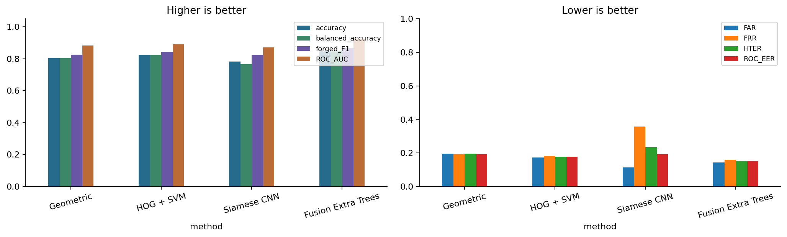
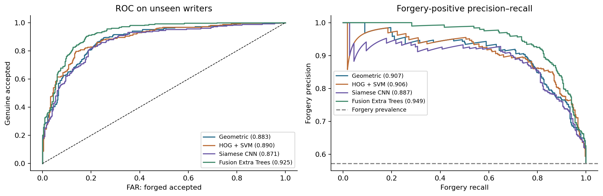

# Signature Forgery Detection

A reproducible Pattern Recognition case study comparing **Geometric features + SVM**, **HOG + SVM**, and a **Siamese CNN** for handwritten signature verification. **Fusion Extra Trees** provides an additional benchmark.

The Jupyter notebook combines dataset auditing, exploratory data analysis (EDA), preprocessing, model training, evaluation, and graphical comparisons.

- [Open the executed notebook](signature-forgery-detection/signature_forgery_detection.ipynb)
- [View measured metrics](signature-forgery-detection/results/notebook_run/metrics.csv)
- [Browse exported figures](signature-forgery-detection/results/notebook_run/figures)

## Importance of signature forgery detection

Handwritten signatures are used to authorize agreements, acknowledge transactions, and approve documents. Forged signatures can lead to financial loss, disputed ownership, unauthorized approvals, and lengthy investigations. Manual inspection can be inconsistent, particularly when reviewers handle many documents or skilled forgeries closely resemble genuine signatures.

Signature verification compares a questioned signature with genuine reference examples. Pattern recognition measures differences in shape, stroke layout, edge direction, and natural writing variation. Automated screening can help reviewers prioritize suspicious documents and make more consistent comparisons.

This project studies **offline verification** using scanned signature images. It does not capture pen pressure, writing speed, or signing dynamics. It verifies a claimed writer against their genuine references; it does not identify an unknown writer.

## Potential use cases

| Area | Example application |
| --- | --- |
| Banking | Flag suspicious signatures on cheques, withdrawal forms, and account instructions. |
| Insurance | Screen signed applications, declarations, and claim documents. |
| Real estate and construction | Assist review of signed agreements, vendor acknowledgements, payment documents, and approval forms. |
| Education | Support review of signatures on administrative forms and certificates. |
| HR and business administration | Check signed employee forms, consent documents, and internal authorizations. |
| Document examination | Provide quantitative comparisons to support an examiner's investigation. |

These are possible applications, not deployment claims. This is an educational experiment on CEDAR. Consequential use requires representative validation, appropriate thresholds, consent and access controls for signature data, and human review. A model score alone cannot establish a document's legal authenticity.

## Methods and training

| Method | Approach |
| --- | --- |
| Geometric features + SVM | Contours, Hu moments, aspect ratio, stroke density/width, and spatial projections; an RBF SVM learns genuine-versus-forged pair differences. |
| HOG + SVM | Histograms of Oriented Gradients describe local edges; an RBF SVM learns descriptor differences and similarity measures. |
| Siamese CNN | A shared convolutional encoder processes both signatures; a symmetric comparison head learns a verification score. |
| Fusion Extra Trees (additional) | An ensemble classifier combines geometric and HOG pair features. |

The notebook uses cached descriptors, training-only scaling, compact validation-based SVM searches, class weighting, and multiple genuine references. CNN training includes AdamW, affine augmentation without wrapping image edges, dropout, learning-rate reduction, gradient clipping, early stopping, and restoration of the best validation checkpoint.

## Dataset and evaluation protocol

The included CEDAR dataset is in `signature-forgery-detection/CEDAR/CEDAR/`:

- **55 writers**, each with **24 genuine + 24 skilled forged** signatures: **2,640 images**.
- **33 training / 8 validation / 14 test writers**, seed 0. Writers do not overlap between splits.
- **6 genuine enrollment references** per writer; the remaining **18 genuine + 24 forged** images are queries.
- Each query is compared against all six references; pair scores are averaged.
- The test set contains **588 queries**: 252 genuine and 336 forged.
- Hyperparameters, CNN checkpoint, and operating thresholds are selected on validation writers, not test writers.
- Image hashes detect exact duplicate content before splitting. EDA that can influence modeling uses training writers.

Labels are **genuine = 1** and **forged = 0**. Higher scores indicate a more genuine match; scores are **not calibrated probabilities**.

Dataset attribution inherited from the original project: [Handwritten Signature Datasets on Kaggle](https://www.kaggle.com/datasets/ishanikathuria/handwritten-signature-datasets). Consult the original CEDAR terms and source dataset conditions before reuse or redistribution; inclusion here does not grant additional rights.

## Measured results

Values below come from [metrics.csv](signature-forgery-detection/results/notebook_run/metrics.csv), using six references and validation-selected thresholds.

| Method | Accuracy | Balanced accuracy | Forged F1 | ROC-AUC | FAR | FRR |
| --- | ---: | ---: | ---: | ---: | ---: | ---: |
| Geometric features + SVM | 80.44% | 80.46% | 0.8244 | 0.8833 | 19.64% | 19.44% |
| HOG + SVM | 82.31% | 82.24% | 0.8424 | 0.8903 | 17.26% | 18.25% |
| Siamese CNN | 78.23% | 76.49% | 0.8232 | 0.8711 | 11.31% | 35.71% |
| Fusion Extra Trees | 85.03% | 84.92% | 0.8675 | 0.9248 | 14.29% | 15.87% |

Fusion has the highest accuracy in this run. The CNN has the lowest FAR, but rejects more genuine signatures at its validation-selected threshold. Accuracy alone misses this trade-off.





### Evaluation metrics

| Metric | Meaning | Preferred direction |
| --- | --- | --- |
| Accuracy | Fraction of correctly classified queries. | Higher |
| Balanced accuracy | Average of genuine recall and forged recall. | Higher |
| Precision, recall, F1 | Reported for both classes; forged recall measures the fraction of forgeries detected. | Higher |
| FAR | Forged signatures accepted / all forged queries. | Lower |
| FRR | Genuine signatures rejected / all genuine queries. | Lower |
| HTER | Half the sum of FAR and FRR at the operating threshold. | Lower |
| ROC-AUC | Ranking performance over thresholds, with genuine as the positive class. | Higher |
| Average precision (AP) | Precision-recall summary, reported for both class orientations. | Higher |
| MCC | Prediction-label correlation accounting for all confusion-matrix entries. | Higher |
| ROC-EER | Descriptive equal-error rate interpolated from the ROC curve. | Lower |

Operating metrics use the **validation-selected threshold**. Test ROC-EER is a descriptive statistic, not a test-selected operating threshold. Confidence intervals resample **writers**, rather than correlated signature pairs.

### Historical baseline

The original script reported accuracy / FAR / FRR of **0.610 / 0.360 / 0.420** for Geometric, **0.708 / 0.225 / 0.360** for HOG+SVM, and **0.611 / 0.393 / 0.385** for Siamese CNN; see [results_cedar.log](signature-forgery-detection/results_cedar.log).

**The old and new tables are not a controlled model-only comparison.** Preprocessing, enrollment/query construction, and reference aggregation changed. The notebook exports a matched one-reference versus six-reference ablation under its own protocol. Do not attribute the difference from historical accuracy solely to improved models.

## Prerequisites

| Requirement | Details |
| --- | --- |
| Python | **Python 3.13 recommended**; the saved run used 3.13.1. Other versions have not been verified for this experiment. |
| Git | For cloning; alternatively download the branch as a ZIP. |
| Notebook editor | VS Code with the **Python** and **Jupyter** extensions, or JupyterLab. |
| Packages | Install [requirements.txt](signature-forgery-detection/requirements.txt): NumPy, pandas, OpenCV, scikit-learn, PyTorch, matplotlib, joblib, and notebook tooling. |
| Hardware | CPU supported; CUDA GPU optional. 8 GB RAM is a practical starting point, with 16 GB preferable. Allow several GB of free disk space for packages, data, and generated checkpoints. |
| Internet | Needed initially to download the project and install packages. Training uses the included dataset. |

No paid service, API key, DeepSeek account, external training data, or pretrained weights are needed. CUDA is selected automatically when `torch.cuda.is_available()`; otherwise the notebook uses CPU.

The saved run used **PyTorch 2.9.0+cpu**, **OpenCV 4.13.0**, and **NumPy 2.4.4**. See [config.json](signature-forgery-detection/results/notebook_run/config.json) for recorded settings and writer splits.

## Download and run

### 1. Download this branch

```bash
git clone --branch improve-signature-notebook --single-branch https://github.com/alby271/SIGNATURE-FORGERY-DETECTION.git
cd SIGNATURE-FORGERY-DETECTION/signature-forgery-detection
```

For a ZIP download, select **improve-signature-notebook** on GitHub, choose **Code → Download ZIP**, extract it, and open the extracted `signature-forgery-detection` folder.

### 2. Create a Python environment and install dependencies

**Windows PowerShell:**

```powershell
py -3.13 -m venv .venv
.\.venv\Scripts\Activate.ps1
python -m pip install --upgrade pip
python -m pip install -r requirements.txt
```

If PowerShell blocks activation, use the environment's Python directly. Changing system execution policy is unnecessary:

```powershell
.\.venv\Scripts\python.exe -m pip install --upgrade pip
.\.venv\Scripts\python.exe -m pip install -r requirements.txt
```

**macOS / Linux, with Python 3.13 installed:**

```bash
python3.13 -m venv .venv
source .venv/bin/activate
python -m pip install --upgrade pip
python -m pip install -r requirements.txt
```

Subsequent `python` commands assume the environment is activated. For the PowerShell fallback, replace `python` with `.\.venv\Scripts\python.exe`.

### 3. Open and run in VS Code (recommended)

1. Open the `signature-forgery-detection` folder in VS Code.
2. Install the **Python** and **Jupyter** extensions if needed.
3. Open `signature_forgery_detection.ipynb`.
4. Choose **Select Kernel → Python Environments**, then select this folder's `.venv`.
5. **Restart the kernel and Run All** to execute cells in order.

The committed notebook contains saved outputs that can be inspected on GitHub without training.

**JupyterLab alternative:**

```bash
python -m pip install jupyterlab
python -m ipykernel install --user --name signature-project --display-name "Python (Signature Forgery)"
python -m jupyterlab
```

Open the notebook and choose **Python (Signature Forgery)** as its kernel. Launch JupyterLab from the `signature-forgery-detection` folder so the dataset path resolves correctly.

### 4. Training settings

The configuration cell defaults to:

```python
SEED = 0
N_REFS = 6
MAX_EPOCHS = 30
PATIENCE = 7
BATCH_SIZE = 64
RETRAIN = True
```

- Use **RETRAIN = True** for the first run after cloning. Generated model files are excluded from Git and must be trained locally.
- **RETRAIN = False** reuses available checkpoints from a previous local run with the **same code, data, split, and settings**. Missing checkpoints are trained automatically; this is not a guaranteed inference-only mode.
- When changing the data, seed, references, or model definitions, retrain and choose a different `OUT` directory. Checkpoint compatibility is not automatically verified.
- Runs write to `results/notebook_run/` and overwrite artifacts with matching names. Copy earlier results or change `OUT` before another experiment to preserve them.

The saved CPU run stopped after **24 epochs**, restoring **epoch 17** as the best validation checkpoint. CNN epochs took approximately 49–86 seconds on that machine. Allow additional time for data loading, feature extraction, SVM searches, and evaluation. Runtime and results can differ across hardware and package versions.

### 5. Run the checks

From `signature-forgery-detection`:

```bash
python test_notebook.py
```

The checks execute definition cells without retraining. They cover metric orientation, threshold ties, writer/enrollment separation, duplicate rejection, score aggregation, preprocessing/features, CNN symmetry/batching, and bootstrap reproducibility.

## Notebook structure and exported artifacts

The notebook maps to the coursework: define a real-world problem, implement three approaches, and compare results visually.

1. Preprocessing and feature representations.
2. Siamese architecture and training helpers.
3. Dataset audit and training-only EDA.
4. Geometric/HOG features and validation-based searches.
5. CNN training and learning curves.
6. Frozen model selection and held-out evaluation.
7. Comparisons, confidence intervals, per-writer performance, and error analysis.
8. Discussion, limitations, and suggested four-student work allocation.

Paths in this table are relative to `signature-forgery-detection/`.

| Path | Purpose |
| --- | --- |
| `signature_forgery_detection.ipynb` | Main notebook with saved outputs. |
| `requirements.txt` | Runtime dependencies. |
| `test_notebook.py` | Checks that do not train models. |
| `CEDAR/CEDAR/<writer>/` | Genuine `original_*.png` and forged `forgeries_*.png` images. |
| `results/notebook_run/metrics.csv` | Full held-out metrics. |
| `results/notebook_run/predictions.csv` | Query-level scores, thresholds, predictions, and labels. |
| `results/notebook_run/config.json` | Seeds, writer splits, and recorded runtime versions. |
| `results/notebook_run/selected_models.json` | Validation-selected model settings and thresholds. |
| `results/notebook_run/manifest.csv` and `pairs_*.csv` | Image hashes, enrollment/query roles, and reference-query pair manifests. |
| `results/notebook_run/cnn_history.csv` | Training loss, validation metrics, learning rate, and timings. |
| `results/notebook_run/hyperparameter_search.csv` | SVM candidates and validation results. |
| `results/notebook_run/confidence_intervals.csv` | Writer-bootstrap intervals. |
| `results/notebook_run/reference_ablation.csv` | One-reference versus six-reference evaluation. |
| `results/notebook_run/per_writer_metrics.csv` | Individual test-writer performance. |
| `results/notebook_run/figures/` | EDA, ROC/PR curves, confusion matrices, learning curves, and error examples. |
| `signature_verify.py` | Original command-line baseline. |

Trained `*.pt` and `*.joblib` models, virtual environments, and temporary runtime files stay local. The generated HOG model can exceed GitHub's ordinary 100 MiB file limit; commit the reproducible notebook and compact results instead.

## Original command-line baseline

From `signature-forgery-detection`, after installing requirements:

```bash
python signature_verify.py --data CEDAR/CEDAR --epochs 10 --plots plots
python signature_verify.py --demo --plots plots_demo
```

These commands run the original baseline, not the notebook experiment. The `--demo` command uses synthetic data; do not present its results as CEDAR performance.

## Limitations

This experiment uses one dataset and one fixed writer split. Eight validation writers provide a limited selection set, and there are only 14 test writers. Bootstrap intervals are conditional on this split. Acquisition artifacts can influence results even when writers are separated. Performance on other scanners, languages, backgrounds, or populations remains unmeasured.

Do not tune models or thresholds using test results and then treat the same test set as fresh evidence. Future work includes repeated predeclared writer splits, cross-dataset testing, more diverse signatures, and calibration for a specific review workflow.

## Contributing

Work on a separate feature branch, run the checks, and record experiment settings with new results. Keep raw dataset changes separate from model/documentation changes. Do not commit environments, credentials, or generated model binaries.

For this contribution, compare `improve-signature-notebook` against `main` when opening a pull request. This branch retains the original implementation and included CEDAR data from `add-signature-forgery-detection`.
